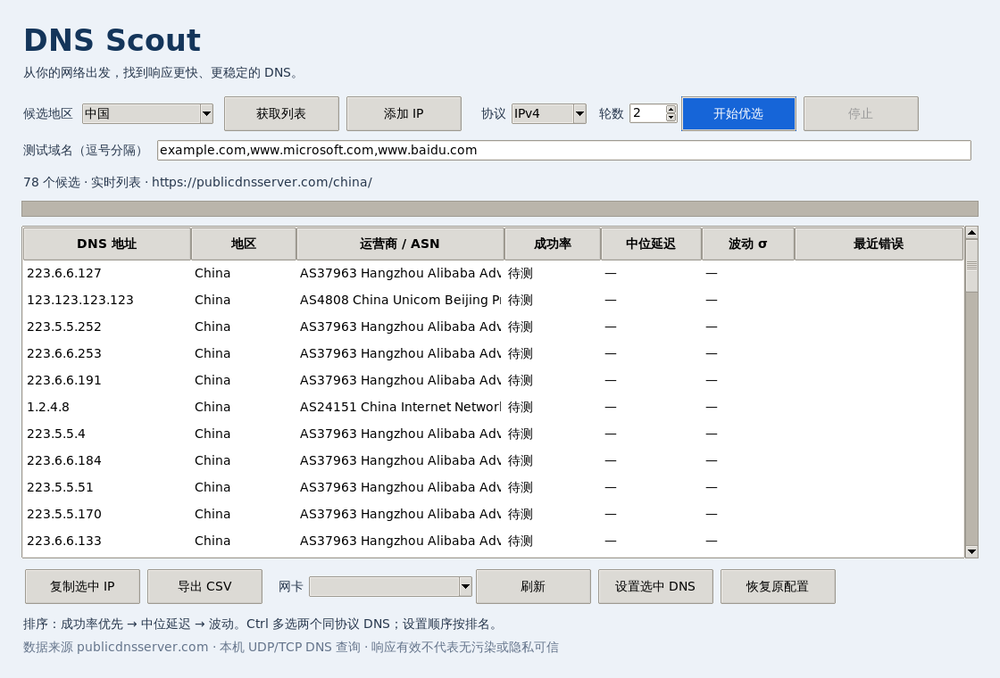

# DNS Scout · DNS 优选 / DNS Optimizer

面向 **Windows 11 x64** 的简体中文 / English 免安装桌面工具。候选列表来自
[publicdnsserver.com](https://publicdnsserver.com/)，排名由用户本机重新测量。

## English quick start

DNS Scout is a portable Windows x64 app with Simplified Chinese and English UI. On first launch it follows the Windows display language; use the language selector in the top-right corner to switch at any time. Your choice is saved in `%LOCALAPPDATA%\DNSScout\settings.json`.

1. Choose a region and select **Get list**, or add public IPv4/IPv6 DNS addresses.
2. Choose a protocol, number of rounds, and test domains, then select **Find best DNS**. Results are ranked by success rate, median latency, and jitter.
3. To change system DNS, refresh and select a network adapter. Fill the preferred and alternate IPv4/IPv6 fields, or select results and choose **Fill selected DNS**.
4. Select **Apply DNS** and confirm the adapter. Windows administrator approval is required. The original configuration is backed up before the first change; **Restore previous settings** restores and verifies it.

Testing DNS never changes system settings. DNS configuration requires explicit confirmation. See the Chinese guide below for measurement details, limitations, and build instructions.

## 中文快速开始

首次启动按 Windows 显示语言选择界面语言，可在窗口右上角随时切换。选择保存在 `%LOCALAPPDATA%\DNSScout\settings.json`。

## 下载和使用

在 [Releases](https://github.com/Freecode100Year/dns-scout/releases) 下载
DNSScout.exe，双击运行，无需安装 Python。

1. 选择地区，点击「获取列表」，也可添加自定义公网 IPv4 / IPv6 地址。
2. 选择协议、轮数和测试域名，点击「开始优选」。默认 3 个域名 × 2 轮，16 路并发。
3. 按成功率、中位响应时间、响应时间标准差依次排序；支持停止、复制、CSV 导出。
4. 如需设置 DNS，点击「刷新」选择网卡，填写 IPv4 / IPv6 各自的「首选 DNS」「备用 DNS」。
   也可 Ctrl 选中结果（每种协议最多两个），点击「填入选中 DNS」，按排名填入后可手动调整主备。
   点击「应用 DNS」可同时设置两种协议。备用可留空；整组留空则保持该协议原配置。
   仅填写备用、主备重复或地址协议不匹配时会提示错误。
5. 确认网卡并接受 UAC。首次修改前备份原配置，重复设置不覆盖原始备份；
   「恢复原配置」恢复该网卡首次修改前的 IPv4/IPv6 静态或自动 DNS 模式并校验。

首次启动不自动联网，不自动修改配置。仅配置子进程请求管理员权限。
UAC 请使用同一用户的管理员授权；另一管理员账户的备份位置会不同。

## 测量与限制

- 真实 A 记录查询，校验响应匹配、RCODE 和 A 答案；UDP 截断时自动 TCP 回退。
- 单次传输超时 1.5 秒，失败计入分母。停止后等待在途查询结束，保留部分结果；
  **部分结果不宜与完整结果直接比较**。
- 中位延迟与波动只统计成功样本，无成功样本显示「—」。
- 可自定义 1–10 个域名；IPv6 指服务器传输地址，查询类型仍是 A。
- 有效响应不代表无污染或隐私可信。不进行 DNSSEC、DoH、DoT 或答案真实性认证，
  不保证提高网页下载速度。
- 网站「最快」是其监测点结果，不代表你的网络；候选页可能仅展示部分服务器，
  工具不声称收录全部全球 DNS。
- 联网仅获取 HTTPS 候选页，并向候选 DNS 查询用户指定域名，不上传测速结果。
- 缓存位于 %LOCALAPPDATA%\DNSScout\cache，离线使用时明确显示年龄。
- 备份位于 %LOCALAPPDATA%\DNSScout\backups，以网卡 GUID 区分；
  恢复校验通过后才删除。修改失败会保留备份，可再次恢复。
- 无数字签名，可使用发布页 SHA256SUMS.txt 校验。

## 源码运行与测试

Python 3.12+，Windows 官方安装包含 Tkinter：

    python -m venv .venv
    .venv\Scripts\python -m pip install -r requirements.txt
    .venv\Scripts\python main.py

测试：

    python -m unittest discover -s tests -v

Windows 打包：

    python -m pip install pyinstaller==6.19.0
    python -m PyInstaller --noconfirm --clean --onefile --windowed --name DNSScout --add-data "scout/configure.ps1;scout" main.py

Windows 用户也可运行 scripts/build-windows.ps1，一次完成测试、打包、冒烟检查和 SHA256。
GitHub Actions 构建流程模板见 docs/windows-build.yml；仓库尚未启用自动构建，可运行 scripts/build-windows.ps1 在 Windows 上完成构建。
当前发布构建的环境与实际验证记录见 docs/TESTING.md。
Windows 11 实机 UAC/网卡修改恢复仍需验收。
配置使用 [微软 DNSClient cmdlet](https://learn.microsoft.com/en-us/powershell/module/dnsclient/set-dnsclientserveraddress?view=win10-ps)；
打包使用 [PyInstaller](https://pyinstaller.org/en/stable/usage.html)。

## 许可

源代码 MIT。DNS 数据属于外部网站，发行版不捆绑其数据库；项目与网站无隶属关系。
依赖：Beautiful Soup（MIT）、dnspython（ISC）、PyInstaller（GPL，含打包例外）、
Python/Tcl/Tk（各自许可）。
